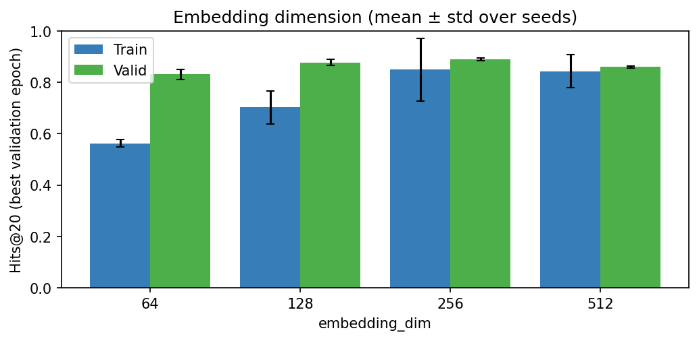
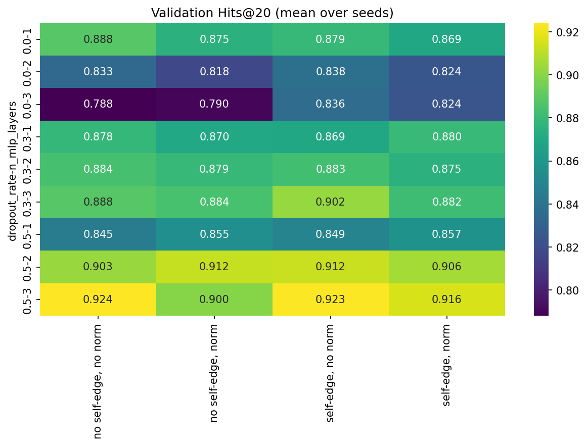
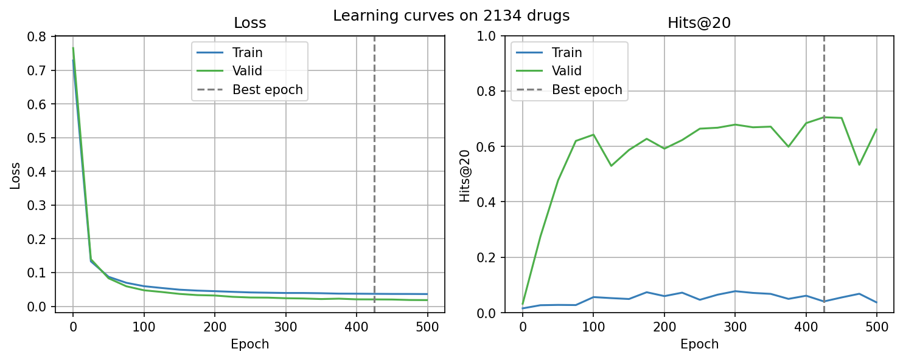
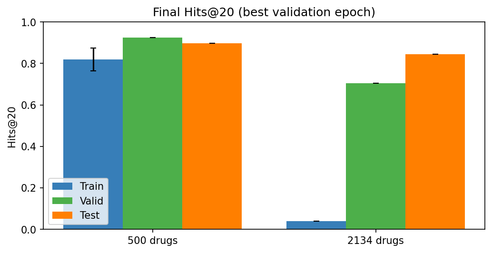

# Drug-Drug Interaction Prediction with a GNN

Predicts drug-drug interactions as a link prediction problem on the [`ogbl-ddi`](https://ogb.stanford.edu/docs/linkprop/#ogbl-ddi) graph. Each drug is a node, each known interaction is an edge, and the model scores whether two drugs interact. The metric is Hits@20.

## Project structure

```
src/ddi_gnn/
  data.py         Loads ogbl-ddi, builds the graph and the train/valid/test pairs
  model.py        GraphSAGE encoder and link predictor
  losses.py       Binary log loss (BCE) and AUC loss
  metrics.py      Hits@K and the metric logger
  train.py        Training loop, best-epoch checkpointing, saving and loading runs
  experiments.py  Multi-seed runs, sweeps and result summaries
  plotting.py     Learning curves, sweep plots and the graph plot
notebooks/
  01_data_exploration.ipynb
  02_experiments.ipynb   Loss, embedding size and hyperparameter experiments
results/                 Figures and summary table written by the experiments notebook
```

## How to use

### In the cloud (Google Colab)

Open `notebooks/01_data_exploration.ipynb` or `notebooks/02_experiments.ipynb` in Colab, select a GPU runtime and run all cells. The first cells clone this repository, install the package and download the dataset.

### In the terminal

```bash
git clone https://github.com/AidaKhaleghi/Drug-Drug-Interaction_GNN.git
cd Drug-Drug-Interaction_GNN
pip install -e .
```

Then, from Python:

```python
import torch

from ddi_gnn.data import load_ddi
from ddi_gnn.experiments import run_seeds

data = load_ddi(root="datasets", node_limit=500, generator=torch.Generator().manual_seed(42))
model_params = {
    "embedding_dim": 256,
    "dropout_rate": 0.5,
    "last_layer_self": False,
    "degree_norm": False,
    "n_mlp_layers": 3,
}

# Model selection: validation only.
runs = run_seeds("my_model", data, model_params, seeds=[0, 1], loss="auc", save_dir="models")

# Final report: also score the test split.
runs = run_seeds("my_model_final", data, model_params, seeds=[0, 1], loss="auc",
                 save_dir="models", evaluate_test=True)
```

## Method

- **Model:** every drug has a learned embedding, refined by GraphSAGE layers on the training graph. An MLP scores a drug pair from the element-wise product of the two embeddings.
- **Training:** for each known interaction, one random non-interacting pair is sampled as a negative. Two losses are compared: BCE and AUC loss.
- **Evaluation protocol:**
  - All choices (loss, embedding size, dropout, ...) are made on the **validation** split only.
  - Each run keeps the weights of its **best validation epoch**.
  - Every setting is trained with several seeds and reported as **mean ± std**.
  - The **test** split is scored only once, for the final selected setting.
- **Data:** experiments use a random subset of 500 drugs (fast tuning), then the selected setting is reused unchanged on 2134 drugs (half of all drugs).

## Results

Experiments were run in `notebooks/02_experiments.ipynb` (400 epochs, 2 seeds on the 500-drug subset). Tuning is done one group at a time.

| Experiment | Compared | Best (validation Hits@20) |
|---|---|---|
| Loss | BCE 0.863 ± 0.008, AUC 0.879 ± 0.001 | **AUC** |
| Embedding dim | 64: 0.831, 128: 0.877, 256: 0.889, 512: 0.859 | **256** |
| Grid (36 settings) | dropout, self-edge, degree norm, MLP layers | dropout 0.5, no self-edge, no degree norm, 3 MLP layers: **0.924 ± 0.006** |

Final result of the selected setting (train, validation, test results):

| Dataset | Train Hits@20 | Valid Hits@20 | Test Hits@20 | Best Epoch | Number of Seeds |
|---|---|---|---|---|---|
| 500 drugs | 0.819 ± 0.055 | 0.925 ± 0.000 | 0.896 ± 0.000 | 360 | 2 |
| 2134 drugs | 0.041 | 0.705 | 0.845 | 425 | 1 |

<p align="center">
  
  
</p>
<p align="center">
  
  
</p>

More tables and figures are in [`results/`](results/).

## Conclusion

- The **AUC loss** beats BCE on validation and is more stable across seeds, since it directly optimizes the ranking of positive over negative pairs.
- An embedding size of **256** works best. Going to 512 lowers validation Hits@20 and the best epoch comes much earlier (about 145 vs 330), a sign of overfitting.
- **Dropout** has the largest effect among the other hyperparameters. The best setting uses a dropout of 0.5 and a deeper (3-layer) MLP.
- The selected setting reaches **0.896 test Hits@20** on 500 drugs, close to its validation score, so model selection did not overfit the validation split much.
- Reused without re-tuning on **2134 drugs**, it reaches 0.845 test Hits@20. The validation curve is still noisy and the train Hits@20 is very low, because on the full set of training negatives only 20 can be ranked above a very large number of positives. Train Hits@20 should be read as a ranking diagnostic, not as an accuracy.

## Future work

- **More architectures:** compare GraphSAGE with Graph Attention Networks (GAT), GCN and GIN, and try learned pair scorers beyond the element-wise product (for example concatenation or a bilinear score).
- **Better negative sampling:** replace uniform random negatives with hard or degree-aware negatives, and test their effect on Hits@20.
- **Richer features:** add drug features such as molecular fingerprints or structure-based embeddings, instead of learning embeddings from the graph alone.
